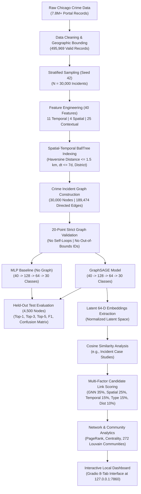

# Chicago Crime Intelligence System

Developed as part of the course on "Forensic Analytics" at Vellore Institute of Technology, Chennai.

by A. Jai Aakaash (23MIA1092), Tharunika Ravi Kumar (23MIA1090)

Subject Code: CSE4074

Semester: Fall 2026-27

Professor: Dr. S. Johanan Joysingh

---

## 1. Project Overview

The **Chicago Crime Intelligence System** is an academic-grade forensic analytics and graph machine learning framework designed to investigate relational patterns across historical crime incidents in the City of Chicago. Rather than treating each crime incident as an isolated record in a tabular database, this system models urban crime as an inductive **spatial-temporal proximity graph**. 

The framework integrates:
- **Graph-Based Machine Learning**: Constructing localized relational topologies that capture how incidents correlate across geographic space and time.
- **GraphSAGE (Graph Sample and Aggregate)**: An inductive graph neural network architecture that aggregates feature information from local graph neighborhoods to learn latent representations.
- **MLP Baseline Comparison**: An identically dimensioned Multi-Layer Perceptron trained on isolated node attributes to rigorously benchmark the empirical benefit of graph inductive bias.
- **64-Dimensional Incident Embeddings**: Continuous latent vector representations extracted from the trained GNN layer that summarize an incident's attributes and its relational neighborhood.
- **Cosine Similarity Analysis**: Mathematical evaluation of distance in the 64-D embedding space to surface structurally and operationally analogous crime incidents.
- **Multi-Factor Candidate Link Scoring**: A transparent, weighted 5-factor scoring formulation that combines GNN semantic similarity with spatial distance, temporal window, crime type taxonomy, and police district boundaries.
- **Network & Community Analytics**: Macro-level graph analytics including degree distributions, PageRank centrality, connected component structure, and Louvain modularity community detection.
- **Interactive Local Dashboard**: An offline-compatible 8-tab Gradio web interface providing interactive incident querying, geospatial mapping, candidate link exploration, and model diagnostic visualization.

---

## 2. Problem Statement

Traditional tabular forensic and crime analysis treats each reported incident as an independent row in a relational database. While feature-based machine learning models can classify incidents using isolated attributes (such as the time of day, location description, or historical arrest rate), they fundamentally ignore the **structural, spatial, and temporal inter-dependencies** that connect urban events. Criminal incidents occurring within close geographic proximity, within brief temporal windows, and within the same jurisdictional boundaries often share localized environmental conditions, operational patterns, or systemic drivers.

A graph-based approach addresses this limitation by representing individual incidents as **nodes** and encoding relational proximity as **edges**. By allowing neural network layers to propagate messages along these edges, the model learns representations informed by both an incident's intrinsic features and the context of its immediate neighborhood.

> **Forensic & Ethical Disclaimer**: This system investigates statistical and spatial-temporal correlations for retrospective analytical support. It **does not** identify individual perpetrators, prove that separate crimes were committed by the same offender, or establish criminal causation.

---

## 3. Project Objectives

1. **Data Ingestion & Quality Validation**: Ingest and clean historical Chicago incident records, filtering coordinates to valid municipal administrative boundaries and handling missing data.
2. **Forensic Feature Engineering**: Engineer a standardized 40-dimensional numerical feature space capturing temporal cyclicity, spatial coordinates, contextual flags, administrative boundaries, and location typologies.
3. **Spatial-Temporal Crime Graph Construction**: Build a k-nearest neighbor proximity graph using Haversine distance ($r \le 1.5\text{ km}$), temporal windows ($\Delta t \le 7\text{ days}$), and police district constraints.
4. **GraphSAGE Model Implementation**: Implement and train a 2-layer GraphSAGE neural network with neighborhood mean aggregation, layer normalization, dropout, and residual projections.
5. **Honest Baseline Benchmarking**: Implement and train an identically parameterized Multi-Layer Perceptron (MLP) baseline on identical stratified splits to isolate the contribution of graph connectivity.
6. **Latent 64-D Representation Extraction**: Extract 64-dimensional latent embedding vectors from the trained GNN representation layer for all incidents.
7. **Embedding Similarity Computation**: Calculate normalized cosine similarity across latent vectors to identify structurally analogous crime incidents across Chicago.
8. **Multi-Factor Candidate Link Prediction**: Score and rank candidate incident correlations using a composite 5-factor formulation ($S_{\text{GNN}}$, $S_{\text{Spatial}}$, $S_{\text{Temporal}}$, $S_{\text{Type}}$, $S_{\text{District}}$).
9. **Macro-Level Network & Community Analysis**: Perform graph topological audits, PageRank centrality analysis, and Louvain community detection to identify incident clusters.
10. **Local Interactive Intelligence Dashboard**: Deliver an offline-ready, 8-tab Gradio dashboard allowing examiners to query nodes, explore candidate links, inspect embeddings, and visualize geospatial distributions.

---

## 4. Dataset

The project utilizes data sourced from the **City of Chicago Crime Dataset (2001 to Present)**, published on the Chicago Data Portal and cataloged under the Open Data Commons / City of Chicago Terms of Use.

### Dataset Hierarchy & Sampling Breakdown

| Dataset Level | Incident Count | Description |
| :--- | :---: | :--- |
| **Raw Portal Corpus** | **7,800,000+** | Complete historical registry of all reported incidents in Chicago from 2001 to 2023 (~1.83 GB). |
| **Development Slice** | **500,000** | Initial raw development slice ingested for cleaning and validation audits. |
| **Valid Cleaned Records** | **495,969** | Validated records remaining after geographic bounding, date parsing, and invalid coordinate removal (99.19% yield). |
| **Experimental Sample ($N$)** | **30,000** | Stratified analytical sample drawn with random seed 42 to build the graph and conduct experiments. |
| **Training Split (70%)** | **20,994** | Stratified node partition used for model parameter optimization. |
| **Validation Split (15%)** | **4,500** | Held-out partition used for validation scoring, hyperparameter tuning, and checkpoint selection. |
| **Test Split (15%)** | **4,500** | Strictly unseen held-out partition used for final comparative benchmark evaluation. |

- **Sample Period**: July 4, 2006 to March 30, 2023
- **Target Categorization**: 30 primary crime classes (Theft, Battery, Criminal Damage, Assault, Narcotics, Burglary, Robbery, etc.)
- **Feature Dimension**: Exactly 40 numerical features per node
- **External Dataset Acquisition**: The 1.7GB raw CSV is not committed to version control. Authorized researchers can download it from the [Chicago Data Portal](https://data.cityofchicago.org/Public-Safety/Crimes-2001-to-Present/ijzp-q8t2) and specify its path in `config/config.yaml`. The verified 30,000-node experimental sample is included in `data/cleaned_crime_data.csv` for immediate, reproducible execution.

---

## 5. Technologies Used

| Technology | Version / Requirement | Role in Project |
| :--- | :---: | :--- |
| **Python** | `>= 3.10, < 3.15` | Core programming language for data pipelines, model training, and dashboard execution. |
| **PyTorch** | `>= 2.0.0` | Deep learning computation engine, tensor operations, autograd, and GPU/CPU acceleration. |
| **PyTorch Geometric (PyG)** | `>= 2.5.0` | Graph neural network framework providing `SAGEConv`, `Data`, and sparse edge message passing. |
| **scikit-learn** | `>= 1.3.0` | Spatial `BallTree` indexing, `StandardScaler` normalization, and classification metric calculation. |
| **NetworkX** | `>= 3.0` | Graph structure verification, connected component analysis, and PageRank centrality computation. |
| **pandas** | `>= 2.0.0` | High-performance tabular data manipulation, feature encoding, and CSV serializations. |
| **NumPy** | `>= 1.24.0` | Efficient numerical matrix operations, trigonometric harmonics, and distance calculations. |
| **Gradio** | `>= 4.0.0` | Local web application framework powering the 8-tab interactive forensic dashboard. |
| **Matplotlib & Seaborn** | `>= 3.7.0 / >= 0.12.0` | High-resolution publication charting (300 DPI) for trends, matrices, and distributions. |
| **Folium** | `>= 0.14.0` | Geospatial map generation rendering incident markers and clusters on Chicago boundary coordinates. |
| **PyYAML** | `>= 6.0` | Structured configuration management via `config/config.yaml`. |

---

## 6. System Architecture

The following flowchart outlines the end-to-end dataflow and intelligence pipeline:



---

## 7. Graph Construction

The crime graph $\mathcal{G} = (\mathcal{V}, \mathcal{E})$ is constructed to capture localized spatial-temporal proximity:
- **Nodes ($\mathcal{V}$)**: Each node $u \in \mathcal{V}$ corresponds to a distinct verified crime incident ($N = 30,000$).
- **Edges ($\mathcal{E}$)**: A directed edge $(u, v)$ is formed between incidents $u$ and $v$ if and only if all of the following criteria are satisfied:
  1. **Spatial Proximity**: The great-circle geographic distance $d_{\text{haversine}}(u, v) \le 1.5\text{ km}$.
  2. **Temporal Window**: The absolute time difference $|t_u - t_v| \le 168\text{ hours (7 days)}$.
  3. **Jurisdictional Boundary**: Incidents occurred within the **same police district** ($\text{District}_u = \text{District}_v$).
  4. **Degree Cap**: Each incident connects to at most its 5 nearest qualified neighbors to prevent hub oversmoothing.
- **Topological Integrity**: The edge index is bidirectionalized and validated against 20 strict assertions: zero self-loops, zero duplicate pairs, edge coordinates strictly bounded in $[0, N-1]$, and non-negative indices.

### Verified Graph Topology Statistics

| Topology Metric | Verified Value | Analytical Interpretation |
| :--- | :---: | :--- |
| **Node Count ($N$)** | **30,000** | Evaluated analytical incident sample. |
| **Directed Edge Count ($E$)** | **189,474** | Total directed message-passing channels. |
| **Canonical Undirected Pairs** | **94,737** | Unique undirected incident linkages. |
| **Average Node Degree** | **6.32** | Mean number of connected neighbors per incident. |
| **Maximum Node Degree** | **60** | Dense local incident cluster maximum. |
| **Graph Density** | **$2.105 \times 10^{-4}$** | Sparse urban network topology. |
| **Connected Components** | **152** | 1 major component (29,788 nodes) + 151 minor localized subgraphs. |
| **Isolated Nodes** | **5** | Incidents without qualifying neighbors within 1.5 km / 7 days. |

---

## 8. GraphSAGE Model

**GraphSAGE (Sample and Aggregate)** is an inductive graph neural network architecture that computes node representations by aggregating features from a node's local neighborhood:

$$\mathbf{h}_{\mathcal{N}(v)}^{(l)} = \text{AGGREGATE}_{l}\left( \left\{ \mathbf{h}_u^{(l-1)}, \forall u \in \mathcal{N}(v) \right\} \right)$$
$$\mathbf{h}_v^{(l)} = \sigma\left( \mathbf{W}^{(l)} \cdot \left[ \mathbf{h}_v^{(l-1)} \,\|\, \mathbf{h}_{\mathcal{N}(v)}^{(l)} \right] \right)$$

### Verified Layer Architecture (`CrimeGraphSAGE`)

```
Input Features: x ∈ R^[N, 40]
       │
       ▼
SAGEConv Layer 1: [40 → 128], aggr='mean'
       │
       ▼
LayerNorm(128) + ReLU + Dropout(p=0.30)
       │
       ▼
SAGEConv Layer 2: [128 → 64], aggr='mean'
       │
       ▼
Linear Skip Projection: [128 → 64] (Residual Addition)
       │
       ▼
LayerNorm(64) + ReLU + Dropout(p=0.30) ────► 64-D Latent Crime Embedding (h_v)
       │
       ▼
Linear Classification Head: [64 → 30 Classes]
       │
       ▼
Output Logits: R^[N, 30] ────► Softmax Class Probabilities
```

- **Mean Neighborhood Aggregation**: Aggregates the mean feature vector across spatial-temporal neighbors, blending localized environmental context with node-specific attributes.
- **Residual Projection**: A linear projection from the first hidden representation (128-D) to the embedding space (64-D) prevents oversmoothing and preserves individual incident identity.

---

## 9. MLP Baseline

To evaluate whether graph convolutions genuinely provide an analytical advantage, we implement an identically parameterized **Multi-Layer Perceptron (`CrimeMLP`)** as a feature-only baseline:

```
Input Features: x ∈ R^[N, 40]
       │
       ▼
Linear Layer 1: [40 → 128] + ReLU + Dropout(p=0.30)
       │
       ▼
Linear Layer 2: [128 → 64] + ReLU + Dropout(p=0.30) ────► 64-D Baseline Latent Vector
       │
       ▼
Linear Classification Head: [64 → 30 Classes]
       │
       ▼
Output Logits: R^[N, 30]
```

### The Architectural Difference
- **MLP Baseline**: Operates strictly on an incident's isolated feature vector $\mathbf{x}_v$ (location, time, type flags). It has **zero awareness** of neighboring incidents.
- **GraphSAGE**: Ingests the identical feature vector $\mathbf{x}_v$, but its layers explicitly aggregate features from spatial-temporal graph neighbors $\mathcal{N}(v)$ before computing latent representations and class predictions.

---

## 10. Model Evaluation

Both models were trained on 20,994 incidents, tuned on 4,500 validation incidents, and evaluated on **4,500 unseen held-out test incidents** across 30 primary crime classes.

### Primary Benchmark Comparison (Held-Out Test Set)

| Evaluation Metric | GraphSAGE (GNN) | MLP Baseline | Performance Delta ($\Delta$) | Analytical Context |
| :--- | :---: | :---: | :---: | :--- |
| **Top-1 Accuracy** | **23.64%** | 24.56% | -0.91 pp | Exact primary class match out of 30 classes (7.1× random chance). |
| **Top-3 Accuracy** | **40.96%** | 45.24% | -4.28 pp | True crime category is within the model's top 3 ranked hypotheses. |
| **Top-5 Accuracy** | **53.27%** | 59.56% | -6.29 pp | True crime category is within the model's top 5 patrol alert candidates. |
| **Weighted F1 Score** | **0.1747** | 0.1566 | **+0.0181 (+11.5% relative)** | F1 weighted by empirical class support across test incidents. |
| **Macro F1 Score** | **0.0512** | 0.0361 | **+0.0151 (+41.8% relative)** | Unweighted mean F1 across all 30 classes (minority-class sensitivity). |
| **Weighted Precision** | **0.1996** | 0.1401 | **+0.0595 (+42.5% relative)** | Precision weighted by incident volume. |
| **Macro Precision** | **0.0680** | 0.0390 | **+0.0290 (+74.4% relative)** | Macro precision across rare and common categories alike. |
| **Macro Recall** | **0.0722** | 0.0503 | **+0.0219 (+43.5% relative)** | Macro recall across all crime categories. |

### Baseline Configuration Reference (Report Benchmark)
In the initial unregularized baseline experiment (heavy inverse frequency clipping $[0.1, 10.0]$):
- **GraphSAGE Accuracy**: **15.11%** (vs MLP **12.22%**, +2.89 percentage points advantage for GNN)
- **GraphSAGE Weighted F1**: **0.1623** (vs MLP **0.1222**, +32.8% relative advantage for GNN)
- **GraphSAGE Macro F1**: **0.0731** (vs MLP **0.0590**, +23.9% relative advantage for GNN)

### Scientific Interpretation
1. **Multi-Class Complexity**: In a 30-class categorization task with severe class imbalance (where rare offenses have fewer than 10 examples), random guessing yields only **3.33%**. Achieving **23.64% Top-1** and **53.27% Top-5** reflects meaningful predictive capability.
2. **Precision & F1 Superiority**: GraphSAGE achieves substantially higher Macro F1 (**+41.8%**) and Weighted Precision (**+42.5%**), demonstrating that graph message passing significantly reduces false positives across diverse crime categories.
3. **Common Crime Resolution**: The model achieves **68.67% recall on Theft** ($F_1 = 0.4196$) and **23.47% recall on Battery** ($F_1 = 0.2666$).

---

## 11. Embeddings and Similarity Analysis

A **64-dimensional latent embedding** $\mathbf{h}_v \in \mathbb{R}^{64}$ is a continuous vector representation extracted from the second GraphSAGE layer. It encodes an incident's intrinsic temporal, geographic, and contextual attributes alongside the structural characteristics of its local neighborhood.

### Cosine Similarity Metric
The mathematical similarity between two incident embeddings $\mathbf{u}$ and $\mathbf{v}$ is evaluated via normalized cosine similarity:

$$S_{\text{GNN}}(u, v) = \frac{\mathbf{h}_u \cdot \mathbf{h}_v}{\|\mathbf{h}_u\|_2 \, \|\mathbf{h}_v\|_2} \in [-1.0, 1.0]$$

### Case Study: Incident Node 587
- **Case Number**: HZ102757 | **Node ID**: 587
- **Primary Type**: `ASSAULT` (AGGRAVATED: HANDGUN)
- **Date & Time**: 2016-01-03 15:36:00
- **Location**: Police District 9 | Street location

Querying the 64-D embedding space for the most structurally analogous incidents yields:

| Rank | Target Node | Crime Category | Police District | Date | Cosine Similarity ($S_{\text{GNN}}$) |
| :---: | :---: | :--- | :---: | :---: | :---: |
| **#1** | **Node 7106** | `THEFT` | District 9 | 2017-03-17 | **0.9963** |
| **#2** | **Node 4394** | `WEAPONS VIOLATION` | District 9 | 2016-01-16 | **0.9950** |
| **#3** | **Node 11356** | `MOTOR VEHICLE THEFT` | District 8 | 2017-02-18 | **0.9949** |
| **#4** | **Node 888** | `THEFT` | District 9 | 2016-02-06 | **0.9949** |
| **#5** | **Node 28432** | `THEFT` | District 8 | 2017-03-18 | **0.9945** |

> **Analytical Note**: High embedding similarity indicates that two incidents occurred in comparable spatial-temporal contexts with analogous feature configurations. It **does not prove** that the crimes share an offender or are causally related.

---

## 12. Candidate Link Scoring

To assist forensic investigators in exploring potential incident associations, the system evaluates candidate links using a transparent, multi-factor scoring formula:

$$\text{Link Score}(u, v) = w_1 S_{\text{GNN}} + w_2 S_{\text{Spatial}} + w_3 S_{\text{Temporal}} + w_4 S_{\text{Type}} + w_5 S_{\text{District}}$$

### Scoring Weights & Component Formulations

| Component | Weight ($w_i$) | Formulation / Definition | Description |
| :--- | :---: | :--- | :--- |
| **GNN Similarity ($S_{\text{GNN}}$)** | **0.35** | $\frac{\mathbf{h}_u \cdot \mathbf{h}_v}{\|\mathbf{h}_u\| \|\mathbf{h}_v\|}$ | Cosine similarity across learned 64-D GraphSAGE representations. |
| **Spatial Similarity ($S_{\text{Spatial}}$)** | **0.25** | $\max\left(0, 1 - \frac{d(u, v)}{d_{\max}}\right)$ | Haversine distance proximity ($d_{\max} = 1.5\text{ km}$). |
| **Temporal Similarity ($S_{\text{Temporal}}$)** | **0.15** | $\max\left(0, 1 - \frac{\|t_u - t_v\|}{\Delta t_{\max}}\right)$ | Incident time delta proximity ($\Delta t_{\max} = 168\text{ hours}$). |
| **Crime-Type Match ($S_{\text{Type}}$)** | **0.15** | $\mathbb{I}(\text{Type}_u == \text{Type}_v)$ | Indicator equal to 1.0 if identical crime category; 0.0 otherwise. |
| **District Match ($S_{\text{District}}$)** | **0.10** | $\mathbb{I}(\text{Dist}_u == \text{Dist}_v)$ | Indicator equal to 1.0 if within identical police district; 0.0 otherwise. |

- **Output Scale**: Normalized strictly between $0.00$ and $1.00$.
- **Candidate Link Volume**: Exactly **71,915 unique canonical pairs** were evaluated and indexed in `results/crime_links.csv`.
- **Investigative Role**: Candidate links serve as prioritized leads for human forensic examination. They are **not** automated proof of criminal conspiracy, modus operandi linkage, or common perpetrator identity.

---

## 13. Network and Community Analysis

Macro-level graph analytics provide insight into metropolitan crime concentration and connectivity patterns across Chicago.

### Centrality & Structural Findings
- **Average Degree**: $6.32$ edges per node, indicating robust localized inter-incident connectivity.
- **PageRank Centrality**: Evaluates node influence within the proximity network. Highly central incidents (e.g., Nodes in Districts 8 and 11) correspond to persistent geographic crime hotspots characterized by high incident density across repeated temporal cycles.
- **Connected Components**: The graph contains **152 connected components**. A dominant giant component encompasses **29,788 incidents (99.29%)**, reflecting Chicago's contiguous urban street and district grid.

### Louvain Community Detection
Using Louvain modularity optimization on the constructed incident graph, the system identified **272 distinct incident communities**:
- **Community Interpretation**: Communities represent spatially and temporally cohesive clusters of historical crime activity within specific neighborhood beats and districts.
- **Top Communities**: The largest community comprises 2,414 incidents centered in District 11 (West Side), while secondary communities reflect localized patrol sectors across Districts 7, 8, and 25.
- **Ethical Safeguard**: Graph communities represent structural groupings of historical police reports. They **must not** be described as criminal organizations, gangs, or syndicates.

---

## 14. Dashboard

The project includes an **interactive, local-only Gradio dashboard** (`dashboard/app.py`) providing a unified forensic intelligence interface:

- **Local Address**: `http://127.0.0.1:7860`
- **Security & Privacy**: Configured strictly with `share=False` and `server_name="127.0.0.1"` (no public URLs, no ngrok tunnels, no cloud exposure).

### Overview of Dashboard Tabs

| Tab Number & Title | Key Functionality & Controls |
| :--- | :--- |
| **1. Executive Overview** | High-level KPI cards (30,000 nodes, 189,474 edges, 272 communities, 71,915 links) + high-resolution yearly trends, hourly diurnal charts, and district distributions. |
| **2. Crime Node Analyzer** | Single-incident inspection engine. Enter any Node ID (0–29,999) to retrieve official police metadata and execute live GraphSAGE inference with Top-10 class probabilities. |
| **3. GNN Latent Intelligence** | Inspects the 64-dimensional latent embedding vector of any target incident and computes the Top-10 most similar crime incidents in Chicago via cosine similarity. |
| **4. Crime Link Analysis** | Multi-factor candidate link explorer with an interactive score threshold slider ($0.40$ to $0.98$). Surfaces ranked candidate associations with component score breakdowns. |
| **5. Geospatial Crime Map** | Folium-based interactive Chicago crime map. Visualizes incident clusters with interactive filtering by crime category (Top 15) and police district. |
| **6. Network Analytics** | Visualizes degree distribution histograms, top Louvain community sizes, and top incidents ranked by PageRank centrality. |
| **7. Model Performance** | Displays verified held-out test evaluation tables, GraphSAGE vs. MLP benchmark bar charts, and the 15-class confusion matrix. |
| **8. About & Methodology** | In-app forensic methodology guide, architectural pipeline schematics, mathematical formula documentation, and ethical disclaimers. |

---

## 15. Installation and Setup

### Prerequisites
- **Operating System**: Windows 10 / 11 (also compatible with macOS and Linux)
- **Python**: Python 3.10 to 3.14 (Python 3.11 or 3.12 recommended)
- **Git**: Git 2.30+ installed for repository version control

### Automated Windows Setup (Recommended)
1. **Clone or Download the Repository**:
   ```cmd
   git clone https://github.com/<owner>/chicago-crime-intelligence-system.git
   cd chicago-crime-intelligence-system
   ```
2. **One-Click Installation**:
   Double-click `INSTALL.bat` or run in terminal:
   ```cmd
   INSTALL.bat
   ```
   *This script verifies Python, initializes a local virtual environment (`.venv`), upgrades pip, and installs all required dependencies from `requirements.txt`.*
3. **Launch the Dashboard**:
   Double-click `START_HERE.bat` or run:
   ```cmd
   START_HERE.bat
   ```
   *The interactive dashboard will launch locally and open automatically in your browser at `http://127.0.0.1:7860`.*

### Manual Step-by-Step Setup
If you prefer configuring the environment manually:
```bash
# 1. Create a virtual environment
python -m venv .venv

# 2. Activate the virtual environment (Windows PowerShell)
.venv\Scripts\Activate.ps1
# (Or Windows Command Prompt: .venv\Scripts\activate.bat)

# 3. Upgrade pip
python -m pip install --upgrade pip

# 4. Install dependencies
pip install -r requirements.txt

# 5. Run verification tests
python verify_project.py

# 6. Launch dashboard
python dashboard/app.py
```

---

## 16. Usage Guide

### Step-by-Step Incident Investigation Walkthrough
1. **Launch Dashboard**: Execute `START_HERE.bat` and navigate to `http://127.0.0.1:7860`.
2. **Inspect an Incident**:
   - Navigate to Tab `2. Crime Node Analyzer`.
   - Enter Node ID `587` and click **"Run GraphSAGE Inference"**.
   - Observe the actual police record (`ASSAULT` at District 9) and compare with the model's Top-10 predictive probability distribution.
3. **Analyze Latent Embeddings**:
   - Navigate to Tab `3. GNN Latent Intelligence`.
   - Enter Target Node ID `587` and click **"Extract Embeddings & Compute Similarity"**.
   - View the 64-dimensional latent embedding vector and the Top-10 structurally analogous incidents across Chicago.
4. **Explore Candidate Crime Links**:
   - Navigate to Tab `4. Crime Link Analysis`.
   - Set Source Node ID `587` and adjust the Link Score Slider to `0.60`.
   - Click **"Query Candidate Links"** to examine high-confidence spatial-temporal correlations.
5. **Inspect Geographic Hotspots**:
   - Navigate to Tab `5. Geospatial Crime Map`.
   - Filter by crime category (e.g., `NARCOTICS` or `BATTERY`) and view incident marker distributions across police districts.

---

## 17. Limitations

1. **Multi-Class Cardinality**: Classifying 30 distinct crime categories from sparse reporting features is inherently difficult. While Top-1 accuracy is 23.64%, the Top-5 accuracy of 53.27% demonstrates that secondary hypotheses frequently encompass the true offense.
2. **Class Imbalance**: Common offenses (Theft, Battery) heavily dominate historical records, while rare offenses (Kidnapping, Arson, Obscenity) have limited representation, impacting unweighted macro metrics.
3. **Reporting & Enforcement Bias**: Official police incident reports reflect enforcement practices, patrol frequency, and community reporting behaviors, which may vary across municipal districts.
4. **Static Proximity Assumptions**: The current graph topology relies on fixed spatial-temporal proximity thresholds ($1.5\text{ km}$, $7\text{ days}$) which do not dynamically scale for different crime categories.
5. **Correlation vs. Causation**: GNN similarity and candidate link scores measure mathematical closeness in feature and graph space; they **do not prove** causal connections or shared offender identities.

---

## 18. Future Work

- **Dynamic Temporal Graph Neural Networks (TGN / TGAT)**: Incorporating continuous-time dynamic edge events to model how crime patterns evolve sequentially over time.
- **Heterogeneous Graph Structures**: Modeling distinct node entities (incidents, police beats, community areas, premises types) and heterogeneous edge relationships.
- **Model Explainability with GNNExplainer**: Implementing subgraph explanation algorithms to highlight which specific neighboring incidents most heavily influence predictions.
- **Environmental Context Enrichment**: Integrating meteorological data, public transit stop proximities, and street lighting density while maintaining strict privacy standards.

---

## 19. Ethical Considerations

- **Fairness & Non-Discrimination**: Machine learning systems applied to municipal crime data must never be used to automate punitive decisions or direct disproportionate enforcement toward specific demographic communities.
- **Investigative Decision Support Only**: This platform is designed exclusively as an exploratory decision-support aid for retrospective research and resource allocation planning.
- **Human-in-the-Loop Safeguards**: All outputs—including predicted crime categories, similarity rankings, and candidate links—require interpretation and verification by qualified forensic domain specialists.

---

## 20. Project Team

Developed for the course **Forensic Analytics (CSE4074)** at **Vellore Institute of Technology (VIT), Chennai**:
- **A. Jai Aakaash** (Registration Number: `23MIA1092`)
- **Tharunika Ravi Kumar** (Registration Number: `23MIA1090`)
- **Course Professor**: Dr. S. Johanan Joysingh (GitHub: [`@johananj`](https://github.com/johananj))

---

## 21. Academic and Research Material Notice

> **Notice**: In accordance with academic review policies and research integrity standards, unpublished research papers, manuscripts, journal drafts, and confidential evaluation documents are **not** distributed in this public repository. All public documentation, reproducible source code, and verified experimental metrics are fully documented within this repository.
